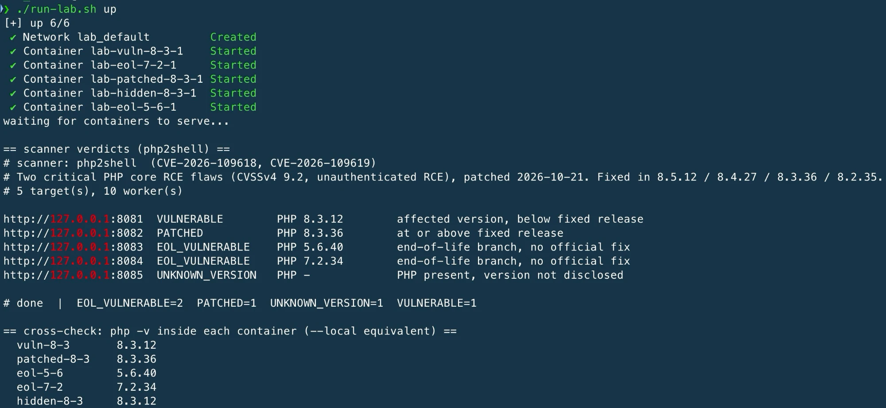

# websiteScanner

A passive, non-intrusive scanner that tells you which of your hosts expose a
software version affected by a known CVE. It covers two critical, recent
remote-code-execution flaws:

- **php2shell** — CVE-2026-109618 / CVE-2026-109619, PHP core RCE (patched 21 Oct 2026)
- **react2shell** — CVE-2025-55182, React Server Components / Next.js RCE

Written in Rust, it builds to a single binary with a CLI and a web UI, using
rustls TLS (no OpenSSL system dependency). A set of shell tools for host-side
checks and mitigation ships alongside it.

> **Detection, not exploitation.** It makes an ordinary `GET` request, like a
> browser, and reads the version the server already discloses. It never sends an
> exploit payload and cannot crash a worker, so it is safe to run against
> production. Point it only at assets you own or are authorised to assess.

## About

A single-binary scanner, with a CLI and a web UI, that inventories which of your
hosts run a PHP or Next.js version affected by php2shell or react2shell. It
confirms the installed version host-side, applies interim php2shell mitigations,
and ships a Docker lab to rehearse the upgrade. It is a detection and
remediation tool for authorised use — not an exploit. See [NOTES.md](NOTES.md)
for scope, caveats, and safety notes.

Suggested GitHub description: *Detection + remediation scanner for php2shell
(CVE-2026-109618/109619) and react2shell (CVE-2025-55182).*
Topics: `security`, `vulnerability-scanner`, `php`, `nextjs`, `cve`, `rust`.

## Quick start

```bash
cargo build --release                       # -> target/release/scanner
./target/release/scanner -f targets.txt     # scan a list of hosts
```

`targets.txt`: one host per line, `#` for comments. A bare host defaults to
`http://`; add `https://` to force TLS. See `targets.example.txt`.

## The vulnerabilities

### php2shell (CVE-2026-109618 / CVE-2026-109619)

| | |
|---|---|
| Impact | Unauthenticated remote code execution (CVSSv4 9.2) |
| Disclosed | Leaked 20 Oct 2026, patched 21 Oct 2026 |
| Fixed in | 8.5.12, 8.4.27, 8.3.36, 8.2.35 |
| Still exposed | PHP 8.1 and older are end-of-life; no official binary fix |

Root cause (PHP Foundation): one flaw is RCE via out-of-memory corruption, the
other via stale global state. On Apache with `mod_php` it can fire on an
unauthenticated request before application code runs.

### react2shell (CVE-2025-55182)

| Product | Fixed in |
|---|---|
| Next.js 15.x / 16.x | 15.0.5, 15.1.9, 15.2.6, 15.3.6, 15.4.8, 15.5.7, 16.0.7 |
| `react-server-dom-webpack` / `-parcel` / `-turbopack` | 19.0.1, 19.1.2, 19.2.1 |

The affected range starts at Next.js 15.0.0 (plus `14.3.0-canary.77+`
prereleases). `14.3.0-canary.76` is a safe downgrade; `.77` and later
14.3 canaries are affected. Fixed canaries include `15.6.0-canary.58` and
`16.1.0-canary.12`. Stable Next.js 14.x is below the range and is **not** affected.

## Usage

### Scan for php2shell (default)

```bash
./target/release/scanner https://example.com            # single host
./target/release/scanner -f targets.txt --workers 20 --json report.json
./target/release/scanner -f targets.txt --vuln-only     # only problems
./target/release/scanner --allow-private 127.0.0.1:8080 # your own LAN/localhost
```

### Scan for react2shell

```bash
./target/release/scanner --sig react2shell -f targets.txt
```

There is **no reliable passive version check** for react2shell — Next.js and
React do not put their version in HTTP responses. The scanner detects that a
host *runs* Next.js / RSC (via `X-Powered-By: Next.js`, `x-nextjs-*` headers, or
`/_next/static/`, `__NEXT_DATA__`, `self.__next_f` in the HTML) and reports
`UNKNOWN_VERSION`. For a verdict, read the installed version on the host:

```bash
npm ls next react-server-dom-webpack 2>/dev/null
```

There is also an opt-in, CLI-only active check — a *non-executing*
error-signature probe (`--active --i-am-authorized`). It sends malformed RSC
input that makes a vulnerable deserializer raise an error (`HTTP 500` + a
`digest` body) and reports a lead (`POSSIBLY_VULNERABLE`), not a verdict. It
carries no code-execution payload and is never reachable from the web UI.

### Reading the output

| Status | Meaning |
|---|---|
| `VULNERABLE` | Exposed version is affected and below the fixed release |
| `EOL_VULNERABLE` | End-of-life branch; affected, no official fix |
| `PATCHED` | At or above the fixed release / below the affected range |
| `POSSIBLY_VULNERABLE` | Active probe saw the vulnerable error signature (a lead) |
| `UNKNOWN_VERSION` | Framework detected, but the version is hidden |
| `NOT_DETECTED` | No fingerprint in the response |
| `ERROR` | The scan failed (DNS, connection, TLS, or a refused internal target) — not a verdict |

Exit code is `2` when any host is vulnerable, `1` when a scan failed or a report
could not be written, and `0` on a clean run — so failures never look like
success in cron or CI. `UNKNOWN_VERSION` is common and good hygiene on the
target's part; confirm those with the host-side check below.

### Web UI

```bash
./target/release/scanner serve --addr 0.0.0.0:8080
```

A single self-contained page: pick the CVE, enter a URL, tick the authorisation
box, get a verdict. JSON endpoint: `GET /api/scan?url=<url>&sig=php2shell`.
Guardrails: passive only, SSRF-blocked (loopback / private / link-local / CGNAT
/ cloud metadata refused, no redirect following), and a 16-request concurrency
cap (HTTP 503 past it). Behind a public deployment, add a reverse proxy with
rate limiting and TLS.

### Host-side version check (definitive)

For a firm verdict on hosts you control — including the ones that hide their
version — read the installed version from the host itself:

```bash
./target/release/scanner --version 7.2.20        # classify a version you have
./target/release/scanner --local --sig php2shell # run `php -v` here
./remote-check.sh -f hosts.txt                   # read `php -v` across a fleet (SSH)
```

`remote-check.sh` uses your existing SSH access (keys / `~/.ssh/config`) and
sends no web probe.

## Fixing php2shell

### Remediation workflow

1. **Confirm which hosts are affected.** A passive scan marks hidden-version
   hosts `NOT_DETECTED` — that is *not* a clean bill of health. Confirm every
   host that serves web traffic with the installed version:
   ```bash
   ssh <host> 'php -v'          # single host
   ./remote-check.sh -f hosts.txt   # a fleet, over SSH
   ```
2. **Apply the interim mitigation** as a stopgap on each affected box (see
   below), making sure it lands on the FPM / Apache SAPI.
3. **Shield at the edge.** At your WAF or web server, reject
   `multipart/form-data` to the affected paths until the host is upgraded.
4. **Upgrade** to a patched PHP and restart workers — the only complete fix. On
   end-of-life OSes this means an OS migration; rehearse the app against PHP 8.3
   in the [lab](#patch-validation-lab) first.

**The only complete fix is to upgrade PHP** to 8.5.12 / 8.4.27 / 8.3.36 /
8.2.35 (or a vendor backport for 7.4–8.1), then **restart the workers**. A
patched binary with old PHP-FPM workers still serving traffic stays vulnerable
until restart. Check the version that serves web requests, which can differ from
the `php -v` CLI binary.

### Interim mitigation script

When you cannot upgrade immediately, `apply-mitigations.sh` applies the published
interim settings. It discovers every PHP on the host (all `php*` / `php-fpm*`
binaries and multi-version / cPanel config trees), reports each version's status,
and writes a conf.d drop-in to each. It is a **stopgap, not a fix**, and it is
reversible (delete the `zz-php2shell-mitigation.ini` it writes).

```bash
sudo ./apply-mitigations.sh                           # dry run: discover + preview
sudo ./apply-mitigations.sh --apply                   # write the drop-in(s)
sudo ./apply-mitigations.sh --apply --reload          # and reload php-fpm / apache
sudo ./apply-mitigations.sh --apply --oom-workaround  # also add the memory_limit set
```

**Apply to the SAPI that serves web traffic**, not just the CLI. The fix has to
land on PHP-FPM or Apache mod_php. The script discovers every `php*` /
`php-fpm*` binary and the common FPM / cPanel config dirs
(`/etc/php/<ver>/fpm/conf.d`, `/etc/php.d`, `/opt/cpanel/ea-php*/root/etc/php.d`,
and the dir each binary reports via `php -i`). Run the dry run first and confirm
it lists the FPM / Apache conf.d before you write:

```bash
sudo ./apply-mitigations.sh          # confirm the FPM/apache dir is listed
sudo ./apply-mitigations.sh --apply --reload
```

Tested across PHP 5.6, 7.2, and 8.3. Verified in a container that the drop-in
takes effect (`session.upload_progress.enabled` and `expose_php` read `Off`
afterward) and that version-only directives like `fatal_error_backtraces`
(8.5+) are skipped on older versions.

| Setting | Why | Note |
|---|---|---|
| `session.upload_progress.enabled = 0` | Blocks the CVE-2026-109619 path | Low risk, broadly recommended |
| `fatal_error_backtraces = 0` | Hardens the error path | PHP 8.5+ only |
| `expose_php = Off` | Stops leaking the version | Reduces fingerprinting, not a fix |
| `memory_limit = -1` | Avoids the CVE-2026-109618 OOM path | `--oom-workaround` only. **Unlimited memory** — only safe with a small `post_max_size` and a container/cgroup memory cap |
| `post_max_size = 32M` | Caps request body | The directive is `post_max_size`, not `max_post_size` |

Do **not** use `RLIMIT_AS` / `RLIMIT_DATA` ulimits to cap memory — the PHP
security team warns they can *trigger* the vulnerable path. Use a container or
cgroup limit instead. If the app does not need uploads, also set
`file_uploads = Off`, and reject `multipart/form-data` at your WAF or web server.

> These interim values come from vendor guidance (CIQ, Microsoft, Sophos), not
> the official PHP advisories (GHSA-w8hw-w9fx-j79w, GHSA-6wmf-4rv5-p3rp).
> Confirm them there before a wide production rollout, especially `memory_limit`.

## Patch-validation lab

A disposable Docker lab in [`lab/`](lab/) runs several PHP versions side by side
so you can watch the verdict change and rehearse an upgrade before touching a
server. No exploit — stock PHP images serving a one-line page.

```bash
cd lab && ./run-lab.sh up      # start + scan;  ./run-lab.sh down to remove
```



## Project layout

| Path | Role |
|---|---|
| `src/signatures.rs` | CVE database, version parse/compare, classification |
| `src/scan.rs` | HTTP fetch, SSRF guard, per-host scan, active probe |
| `src/web.rs` | web server, embedded page, JSON endpoint |
| `src/main.rs` | CLI, flags, concurrency, reports, host-side checks |
| `apply-mitigations.sh` | discover all PHP versions and apply the interim drop-in |
| `remote-check.sh` | definitive `php -v` check across a fleet over SSH |
| `verify.sh` | dependency-free header-based check (cross-checks the binary) |
| `lab/` | Docker patch-validation lab |

## Build and test

```bash
cargo test            # unit tests: version logic, classify, SSRF guard
cargo build --release # single ~2 MB binary, copy it to deploy — no runtime needed
```

## Extending it

Signatures live in `src/signatures.rs`. Each `Signature` has an `extract_version`
function (reads headers/body, returns a version) and a `fixed_by_branch` table.
To add a CVE, define a `Signature`, register it in `all()`, and add tests for
its fingerprint and classification.

## Limitations

- Passive HTTP scan cannot see a version the server hides (`UNKNOWN_VERSION`);
  use the host-side check for those.
- Connections use one validated address snapshot per scan, including both active
  probe requests. Private targets remain blocked in the web service. The CLI
  can opt in with `--allow-private`. Environment proxies are disabled.
- Body-read failures (including early EOF and timeouts) produce `ERROR`. The
  scanner samples at most 65,536 decoded body bytes; reaching that limit does
  not verify the rest of the response.
- The web service admits at most 16 concurrent scans and returns HTTP 503 when busy.
- Reads one URL per host (the root) and does not follow redirects; point it at
  the final URL if a version leaks on a specific path.
- react2shell has no passive version check; the scan confirms the framework
  only.
- TLS verification stays on; a self-signed cert is reported, not bypassed.
- **Distro packages may be backport-patched.** Linux distributions fix CVEs
  without changing the upstream `x.y.z` (e.g. Ubuntu's `8.3.6-0ubuntu0.24.04.13`
  carries the fix but reads below `8.3.36`). The tool flags a distro build in
  its verdict and preserves the full version token in CLI, JSON, and web
  results. Its actionable status compares the upstream version only. For those
  packages confirm against your distribution's
  security advisory rather than the upstream version alone.

## License

MIT — see [LICENSE](LICENSE).
